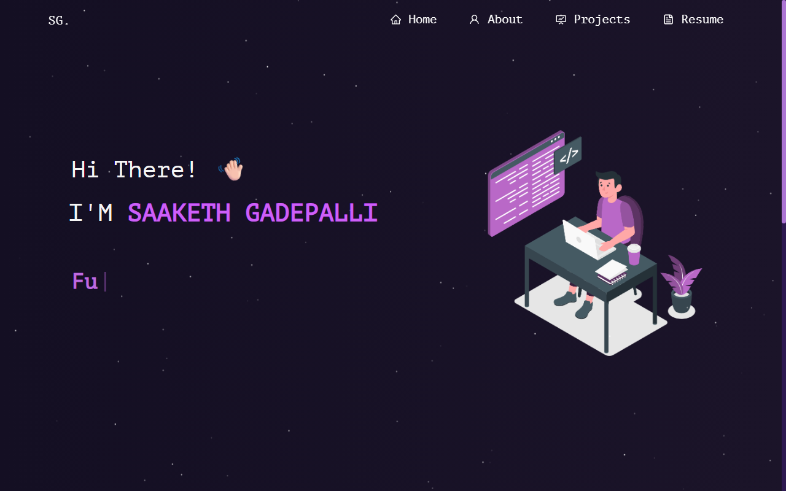
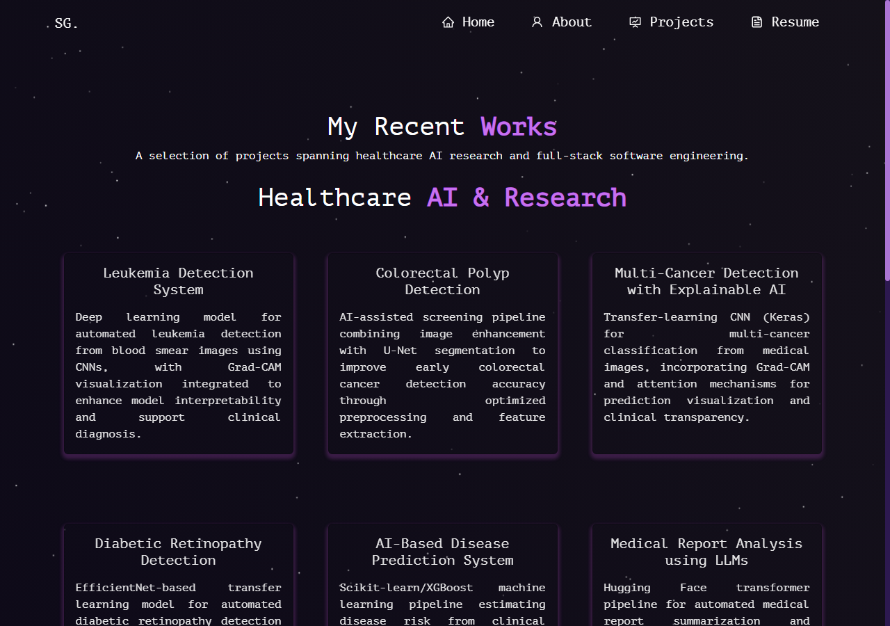

<h2 align="center">
  Saaketh Gadepalli - Portfolio
</h2>

  Personal portfolio site showcasing my work in full-stack development and applied AI/ML for healthcare diagnostics.

  <a href="https://saaki-resume-portfolio.vercel.app/" target="_blank">🔗 Live Site</a>

  
    
  

 

  
  
  
  

## About

I'm a Computer Science undergraduate at Chennai Institute of Technology, building production-grade software end-to-end - from REST APIs and database design to training and deploying explainable deep learning models for medical imaging. This site is where I showcase my projects, skills, and experience.

## Built With

- React.js
- React Router
- React-Bootstrap & CSS3
- Vercel (deployment)

## Features

**Multi-page layout** - Home, About, Projects, Resume

**Responsive design** - works across desktop, tablet, and mobile

**Live resume preview** - view and download my current resume directly from the site

## Getting Started

Clone this repository. You'll need `node.js` and `git` installed locally.

### Installation and Setup

1. Install dependencies: `npm install`
2. Run the app in development mode: `npm start`

Open [http://localhost:3000](http://localhost:3000) to view it in the browser. The page reloads automatically on edits.

### Project Structure

All page content lives under `/src/components/`, organized by section (`Home`, `About`, `Projects`, `Resume`).

## Let's Connect

  
  
  
  

### Show your support

Give a ⭐ if you like this website!
